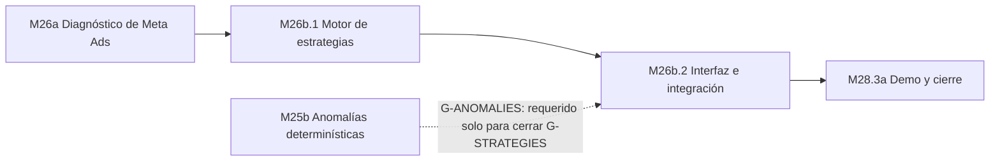

# Propuesta de enmienda — M26b Estrategias publicitarias verificables

**Estado:** APROBADA por el usuario el 2026-11-16 e integrada en la ruta `meta_first` en esa fecha. La aprobación incorpora M26b.1, M26b.2, `G-STRATEGY-ENGINE`, `G-STRATEGIES`, `DEC-26` y `CA-82` a `CA-94`; no aprueba las futuras specs o planes hijos, no autoriza implementación por sí sola y no cierra ningún gate. `docs/FASES/FASE1/M26b/spec.md` conserva su estado y bloqueo hasta la migración posterior expresamente solicitada por el usuario.

## 1. Objeto y justificación

Incorporar a la ruta `meta_first` una funcionalidad de estrategias publicitarias verificables en dos microfases independientes y revisables:

- `M26b.1`: motor determinístico, adaptador server-only y pruebas;
- `M26b.2`: interfaz, integración, demo sintética, pruebas y cierre de `G-STRATEGIES`.

La división respeta el límite ordinario de hasta 8 horas por microfase de `AGENTS.md`; no solicita una excepción. La funcionalidad reutiliza el detector M25b y las lecturas/evidencias de M26a, no agrega migraciones ni RPC, no persiste decisiones del usuario y no escribe en Meta, Tiendanube ni GA4.

La enmienda es necesaria porque la ruta vigente excluye recomendaciones publicitarias y solo admite como ampliación de métricas derivadas las comparaciones determinísticas de M25b. La spec borrador de M26b no puede prevalecer sobre la Parte I vigente de `meta_first/plan.md` ni autorizar por sí sola archivos, microfases o gates nuevos.

## 2. Fuentes y jerarquía

La propuesta se preparó contra:

1. `AGENTS.md`, incluido el contrato de ejecución y el contrato documental;
2. `docs/PIPELINE.md`;
3. `docs/FASES/FASE1/meta_first/plan.md`, Parte I y contrato de ejecución;
4. `docs/FASES/FASE1/meta_first/spec.md`;
5. `docs/PROJECT_STATE.md`;
6. `docs/FASES/FASE1/M26b/spec.md`, en estado `BORRADOR` y con 18 decisiones cerradas;
7. `docs/_templates/mf-spec.md` y `docs/_templates/mf-plan.md`;
8. código, pruebas y contratos vigentes de M25b y M26a.

Si esta propuesta contradijera una fuente superior, la contradicción debe resolverse en la enmienda antes de crear o aprobar las specs hijas. La autorización del equipo y las decisiones del usuario permiten preparar la propuesta; no sustituyen la aprobación documental de la enmienda.

## 3. Decisiones expresas que originan esta versión

| ID | Decisión | Motivo | Usuario | Fecha |
|---|---|---|---|---|
| D-EM26b-01 | Incorporar `G-STRATEGY-ENGINE`, cerrado por M26b.1 y habilitante de M26b.2 | Dar a cada microfase una condición de salida y entrada inequívoca | Usuario | 2026-11-16 |
| D-EM26b-02 | Incorporar `G-STRATEGIES` como dependencia adicional de M28.3a, sin eliminar dependencias existentes | Integrar la funcionalidad al recorrido final sin relajar gates vigentes | Usuario | 2026-11-16 |
| D-EM26b-03 | Mantener el alcance determinístico, manual y sin LLM definido durante el Grill Me | Preservar la autoridad del servidor, el alcance read-only y las decisiones D-M26b-03, D-M26b-10 y D-M26b-15 | Usuario | 2026-11-16 |

Estas decisiones cerraron los tres puntos de diseño que estaban pendientes para redactar la propuesta. Por sí solas no aprobaban `DEC-26`, `CA-82` a `CA-94`, las fichas operativas ni los cambios de ruta; esos elementos quedaron aprobados después, mediante la aprobación expresa de la enmienda registrada en el estado de este documento.

## 4. Estado de entrada y compromisos que no cambian

- `G-DIAG` está cerrado y habilita actualmente M16e.
- `G-TIENDA` está cerrado y M16f es la siguiente microfase habilitada, pendiente de spec y plan aprobados.
- La implementación de M25b existe, pero `G-ANOMALIES` sigue pendiente.
- M28.3a espera actualmente `G-CHAT`, `G-ANOMALIES`, `G-DIAG`, `G-TIENDA` y `G-GA4-FUSION`.
- M16f conserva su dependencia de `G-TIENDA`, su alcance, sus archivos y `G-GA4-FUSION`.
- M26b no depende de GA4 para comenzar ni para producir el MVP de estrategias.
- `G-ANOMALIES` no bloquea el comienzo de M26b.1 ni M26b.2; sí bloquea el cierre de `G-STRATEGIES`.
- El MVP continúa siendo read-only sobre sistemas externos y aislado por tenant resuelto en servidor.
- El LLM no genera ni modifica recomendaciones, prioridades, cifras, estados o políticas. La integración futura con chat permanece en backlog sin ID reservado.
- No se agrega persistencia de aceptación, descarte, ejecución o resultado posterior de las recomendaciones.

## 5. Conflicto documental y resolución propuesta

### 5.1 Exclusión vigente

La Parte I de `meta_first/plan.md` excluye recomendaciones y explicaciones causales, y la sección 2 de `meta_first/spec.md` excluye benchmarks, recomendaciones de presupuesto, causalidad y evaluación de rentabilidad.

### 5.2 Excepción estrecha

No se propone borrar esas exclusiones. Se propone agregar una excepción limitada a M26b.1 y M26b.2:

> M26b.1 y M26b.2 pueden producir recomendaciones manuales, determinísticas y versionadas desde evidencia propia de PRAXA. El catálogo de acciones es cerrado; no recomienda montos ni porcentajes, no explica causalidad, no evalúa rentabilidad, no promete resultados y no usa un LLM como fuente de autoridad.

Todo lo no incluido expresamente en esa excepción continúa fuera de la ruta.

## 6. Cambios exactos propuestos en `meta_first/plan.md`

### 6.1 Encabezado de enmiendas

Agregar una entrada «Enmienda M26b — Estrategias publicitarias verificables» que registre:

- aprobación expresa de la enmienda y fecha, cuando ocurra;
- vínculo a este documento;
- incorporación de M26b.1, M26b.2, `G-STRATEGY-ENGINE`, `G-STRATEGIES`, `DEC-26` y `CA-82` a `CA-94`;
- posición paralela con M16f después de `G-DIAG`;
- dependencia de `G-ANOMALIES` solo para cerrar `G-STRATEGIES`;
- ausencia de LLM, persistencia, migraciones, RPC y escrituras externas;
- aclaración de que la enmienda no aprueba las specs ni los planes hijos.

### 6.2 Parte I, tabla I.1

Agregar dos filas sin alterar las existentes:

| Microfase original | En esta ruta | Relación propuesta |
|---|---|---|
| — | `M26b.1` — Motor de estrategias publicitarias | Nueva; después de `G-DIAG`, planificada en paralelo con M16f |
| — | `M26b.2` — Interfaz e integración de estrategias | Nueva; después de `G-STRATEGY-ENGINE`; cierra `G-STRATEGIES` |

### 6.3 Parte I, alcance excluido

Conservar las exclusiones existentes y añadir la excepción estrecha de la sección 5.2. La expresión comercial «con IA» no autoriza generación mediante LLM: el contrato normativo usa «estrategias publicitarias verificables» y define un motor determinístico.

### 6.4 Parte I, mapa de la ruta

Agregar la rama:

La rama vigente `M26a → M16e → M16f → M28.3a` permanece intacta. La posición paralela con M16f es únicamente una autorización de planificación; no agrega `G-TIENDA` como dependencia de M26b.1 y no deroga la regla de `AGENTS.md` de ejecutar una sola microfase por vez, únicamente cuando el usuario la solicite.

### 6.5 Parte I, gates

Modificar y agregar las filas necesarias para que queden estas relaciones:

| Gate | Se aprueba en | Habilita o condiciona |
|---|---|---|
| `G-DIAG` | M26a | M16e y M26b.1 |
| `G-STRATEGY-ENGINE` | M26b.1 | M26b.2 |
| `G-ANOMALIES` | M25b | M28.3a y el cierre de `G-STRATEGIES`; no el comienzo de M26b.1 o M26b.2 |
| `G-STRATEGIES` | M26b.2 | M28.3a, junto con todas sus dependencias vigentes |

No se cambia ninguna otra dependencia. En particular, `G-TIENDA → M16f` y `G-GA4-FUSION → M28.3a` continúan vigentes.

### 6.6 Parte I, fichas operativas

Agregar las fichas completas de las secciones 8 y 9 de esta propuesta, usando la plantilla ordinaria de microfase y sin excepción al límite de tamaño.

### 6.7 Parte II

Agregar, sin renumerar las secciones existentes:

- `II.14d — M26b.1 Motor de estrategias publicitarias`;
- `II.14e — M26b.2 Interfaz e integración de estrategias`.

Cada sección debe contener el procedimiento TDD, los archivos exactos de la sección 12, la trazabilidad con la spec hija y las condiciones de parada. `II.15 — M28.3a` conserva su número.

Actualizar `II.15` solo para:

- agregar `G-STRATEGIES` a sus dependencias;
- incluir la pantalla de Estrategias en la demostración;
- exigir el estado de validación comercial que produzca M26b.2;
- conservar todos los pasos y gates anteriores.

### 6.8 Parte III

- **III.1:** agregar `DEC-26` con el texto propuesto en la sección 10.1.
- **III.2:** agregar las intervenciones del usuario de M26b.1 y M26b.2.
- **III.3:** agregar las verificaciones obligatorias de ambas microfases.
- **III.8:** agregar la salida visible de M26b.2 y declarar que M26b.1 no agrega por sí sola una pantalla pública.
- **III.9:** conservar las condiciones de parada existentes; una dependencia no cerrada o un archivo no autorizado sigue obligando a frenar.

## 7. Cambio propuesto en `docs/PROJECT_STATE.md`

Este archivo se modifica únicamente después de aprobar e integrar la enmienda:

- «Siguiente habilitada» debe indicar M16f y M26b.1 como trabajos documentales habilitados en paralelo, cada uno todavía sujeto a spec y plan aprobados antes del código.
- «Trabajo paralelo autorizado» debe incorporar M26b.1 y corregir el estado operativo de M25b: su código está integrado en `main`, M26b.1 puede reutilizarlo y `G-ANOMALIES` continúa pendiente. La integración del código no equivale a aprobación del gate ni habilita por transitividad el cierre de `G-STRATEGIES`.
- La espera de M28.3a debe sumar `G-STRATEGIES`, sin retirar ninguno de los cinco gates vigentes.
- M26b.2 no figura como habilitada hasta el cierre de `G-STRATEGY-ENGINE`.

No se copian allí criterios, decisiones técnicas, conteos de pruebas ni detalle del motor.

## 8. Ficha propuesta — M26b.1

### M26b.1 — Motor de estrategias publicitarias

**Objetivo.** Construir un motor determinístico y versionado que transforme anomalías M25b, configuración/evidencia de M26a y métricas persistidas en recomendaciones manuales con evidencia y plan de comprobación, sin persistir resultados ni escribir en sistemas externos.

**Implementación requerida.** Contrato Zod, catálogo cerrado de reglas y acciones, aritmética decimal, orden/deduplicación/truncamiento determinísticos, adaptador server-only, reutilización de loaders vigentes y pruebas unitarias/remotas de aislamiento, RLS, rendimiento y cero escrituras.

**Procedimiento del asistente.** Seguir la spec y el plan aprobados de M26b.1; desarrollar mediante TDD; reutilizar M25b y M26a sin duplicar sus reglas o RPC; detenerse ante cualquier archivo no autorizado, dependencia no cerrada o contradicción con la ruta.

**Evidencia de cierre.** Sesión reproducible con comandos y resultados; trazabilidad de cada criterio y prueba; evidencia de Data API real contra el proyecto desechable; medición de rendimiento con fixture máximo; ausencia de secretos, UUID reales y escrituras.

**Criterio de aceptación.** `CA-82` a `CA-91` aplicables satisfechos, pruebas de regresión aprobadas y salida idéntica para entradas idénticas.

**Pruebas.** Unitarias focales; regresión de anomalías y evidencia diagnóstica; `npm run db:check:test`; `npm run test:policies`; `npm run test:app`; `npm run verify`; medición de rendimiento definida en la spec aprobada.

**Condición para avanzar.** El usuario aprueba `G-STRATEGY-ENGINE` después de completar pruebas, revisiones y evidencia. Ese gate habilita M26b.2; no cierra `G-STRATEGIES` ni requiere todavía `G-ANOMALIES`.

**Dependencias.** `G-DIAG` cerrado; código M25b integrado disponible. `G-ANOMALIES`, `G-TIENDA` y `G-GA4-FUSION` no son dependencias de implementación.

**Intervención requerida del usuario.** Aprobar spec y plan por separado según `docs/PIPELINE.md`; realizar las acciones Git o remotas que el plan aprobado reserve al usuario; aprobar expresamente `G-STRATEGY-ENGINE`. No debe compartir secretos ni implementar código.

## 9. Ficha propuesta — M26b.2

### M26b.2 — Interfaz, integración y gate de estrategias

**Objetivo.** Exponer la salida verificada de M26b.1 en una pantalla protegida, con estados honestos, demo sintética exclusiva y rotulada, recorrido autenticado real y evidencia suficiente para decidir `G-STRATEGIES`.

**Implementación requerida.** Página y navegación de Estrategias, tarjetas accesibles, advertencias y estados de datos, enlace a Diagnóstico cuando falta objetivo, demo ficticia separada, integración server-only con el motor y pruebas de componentes, sesión y regresión.

**Procedimiento del asistente.** Seguir la spec y el plan aprobados de M26b.2; consumir sin modificar la salida autoritativa de M26b.1; no recalcular reglas en la UI; no mezclar demo con datos reales; detenerse si un gate o recorrido obligatorio no puede acreditarse.

**Evidencia de cierre.** Pruebas automatizadas, remotas, RLS y de seguridad; recorrido autenticado con una cuenta real; recorrido de la demo sintética; captura textual redactada de estados y limitaciones; declaración «sin validación comercial» cuando no exista actividad real suficiente.

**Criterio de aceptación.** `CA-92` a `CA-94`, además de las invariantes compartidas de `CA-82`, `CA-85` a `CA-90`, satisfechos sin relajar la salida de M26b.1.

**Pruebas.** Para cerrar M26b.2 son obligatorios `npm run db:check:test`, `npm run test:policies`, `npm run test:app -- tests/app/meta-strategies.test.ts`, `npm run verify`, las pruebas focales de componentes, el recorrido autenticado con una cuenta real y el recorrido de la demo sintética. También se ejecuta la regresión del contrato del motor. Ninguna prueba remota, RLS o de seguridad puede omitirse por existir la demo; la demo no reemplaza ninguna suite.

**Condición para avanzar.** El usuario solo puede aprobar `G-STRATEGIES` cuando estén cerrados `G-STRATEGY-ENGINE` y `G-ANOMALIES`, pasen todas las pruebas y se completen ambos recorridos. El gate puede cerrarse técnicamente sin actividad real suficiente si se registra «sin validación comercial».

**Dependencias.** `G-STRATEGY-ENGINE` para comenzar. `G-ANOMALIES` para cerrar el gate, no para comenzar la implementación. No depende de GA4.

**Intervención requerida del usuario.** Aprobar spec y plan por separado; coordinar publicación y recorrido autenticado real; recorrer la demo sintética; aprobar expresamente `G-STRATEGIES`. Las acciones externas se ejecutan solo cuando el plan aprobado las solicite.

## 10. Contrato propuesto para `meta_first/spec.md`

### 10.1 Nueva decisión de ruta

Agregar a la sección 3 y a III.1 del plan:

| ID | Decisión propuesta | Estado al integrar |
|---|---|---|
| `DEC-26` | Estrategias publicitarias verificables en M26b.1 y M26b.2: motor determinístico, manual, versionado, sin LLM autoritativo, persistencia ni escrituras externas; M26b.1 después de `G-DIAG`, M26b.2 después de `G-STRATEGY-ENGINE`; `G-ANOMALIES` requerido para cerrar `G-STRATEGIES`; `G-STRATEGIES` requerido por M28.3a | Cerrada por aprobación expresa de la enmienda |

### 10.2 Nueva sección `§16b — Estrategias publicitarias verificables`

Agregar los siguientes criterios. La numeración continúa el máximo vigente `CA-81`:

- **CA-82 — Contrato y determinismo.** La salida se valida con un contrato versionado e incluye estado, versión, recomendación, prioridad, acción, evidencia y plan de comprobación. Entradas idénticas producen salida idéntica. Los cálculos usan aritmética decimal explícita y no dependen de un LLM.
- **CA-83 — R1 y M25b.** R1 reutiliza anomalías válidas de M25b y su contrato 7+7; no duplica el detector. Solo se genera con evidencia suficiente y conserva procedencia hacia las observaciones utilizadas.
- **CA-84 — R2/R3 y muestra.** R2 usa aumento de gasto mayor o igual a 30 % sin mejora de resultados, o empeoramiento del costo por resultado mayor o igual a 25 %. R3 usa mejora del costo por resultado mayor o igual a 25 %, y una anomalía crítica de la misma entidad bloquea R3. Exigen 28 días actuales, cero días abiertos, cuenta 28+28 completa, al menos 1.000 impresiones, 100 clics y 30 resultados actuales, al menos 30 resultados anteriores y gasto/costo anterior calculable. No se exigen impresiones o clics anteriores por campaña; la limitación se muestra y prueba. Cada cuenta o campaña se compara únicamente contra su propio historial: no se usan rankings, benchmarks ni comparaciones entre objetivos diferentes. Datos insuficientes o inconsistentes no producen R2/R3.
- **CA-85 — Acciones manuales.** El catálogo cerrado es `review`, `consider_reduce` y `consider_controlled_test`. Son sugerencias manuales, nunca órdenes ni automatizaciones. `consider_reduce` solo aparece ante R2 o CPA crítico compatible, con evidencia suficiente, prudencia e incertidumbre. No se recomiendan importes o porcentajes ni se prometen resultados.
- **CA-86 — Objetivo y CPA de compras.** Sin objetivo configurado, R1 puede mostrarse con evidencia, R2/R3 quedan no evaluadas y la UI enlaza a Diagnóstico sin duplicar configuración. Con objetivo distinto de compras, la anomalía se rotula «CPA de compras atribuidas por Meta», aclara que no representa el costo del objetivo, solo permite `review` y no alimenta R2/R3.
- **CA-87 — Prioridad y límite.** Se conservan todas las recomendaciones `high` y hasta diez adicionales `medium` o `low`. El orden y la deduplicación son determinísticos. `truncated` informa cuántas recomendaciones no prioritarias quedaron fuera; nunca oculta una `high`.
- **CA-88 — Explicación y comprobación.** Cada recomendación explica qué datos la justifican, sus limitaciones y cómo comprobar la acción. M26b no guarda aceptación, descarte, ejecución ni resultados posteriores.
- **CA-89 — Estados honestos.** La salida distingue datos suficientes, insuficientes, no evaluables, inconsistentes y errores. No inventa métricas, objetivos o recomendaciones. La UI conserva esa semántica y no recalcula reglas.
- **CA-90 — Seguridad y fronteras.** El tenant se resuelve en servidor; datos reales se leen con el aislamiento y RLS vigentes; no se acepta `company_id` del cliente; no hay SQL, RPC, migraciones, escritura externa, integración con chat ni consulta directa nueva a Meta. La demo es exclusiva y no atraviesa loaders reales.
- **CA-91 — Verificación de M26b.1.** Pruebas unitarias y remotas cubren bordes inclusivos, precisión, faltantes, orden, deduplicación, truncamiento, tenant A/B, RLS, reutilización de lecturas, cero escrituras y rendimiento del fixture máximo conforme a la spec aprobada.
- **CA-92 — Interfaz.** La pantalla protegida muestra metodología, versión, evidencia, prioridad, acción manual, incertidumbre, plan de validación, estados de datos y navegación. Sin objetivo, muestra el aviso y enlace a Diagnóstico. No expone UUID, secretos ni identificadores sensibles.
- **CA-93 — Demo sintética.** M26b.2 incluye una demo ficticia, exclusiva, inequívocamente rotulada y separada de datos reales. El gate exige recorrer la demo y la cuenta autenticada real. La demo no demuestra valor comercial ni sustituye pruebas automatizadas, remotas, RLS o de seguridad.
- **CA-94 — Gate.** `G-STRATEGIES` requiere `G-STRATEGY-ENGINE`, `G-ANOMALIES`, todas las pruebas, recorrido real y demo. Puede cerrarse técnicamente con una cuenta real sin actividad suficiente solo si se registra expresamente «sin validación comercial». El gate se agrega a M28.3a sin eliminar dependencias existentes.

### 10.3 Verificación transversal

Actualizar la tabla de verificación de la spec de la ruta para agregar:

- motor/adaptador de estrategias: contratos, determinismo, RLS, tenant A/B, cero escrituras y rendimiento;
- interfaz: estados, accesibilidad, sesión, objetivo ausente y advertencia del CPA de compras;
- demo y gate: separación sintética/real, ambos recorridos y estado de validación comercial.

## 11. Dependencias y gates consolidados

| Elemento | Para comenzar | Para cerrar | Habilita |
|---|---|---|---|
| M26b.1 | `G-DIAG`; código M25b integrado | Pruebas, revisiones, evidencia y aprobación del usuario | `G-STRATEGY-ENGINE` |
| M26b.2 | `G-STRATEGY-ENGINE` | Pruebas y recorridos; además `G-ANOMALIES` para el gate final | `G-STRATEGIES` |
| `G-STRATEGIES` | M26b.2 implementada y `G-ANOMALIES` cerrado | Aprobación expresa del usuario | M28.3a, junto con todos sus gates vigentes |

La mera integración del código M25b no equivale a `G-ANOMALIES`. La implementación de M26b puede avanzar con el detector existente; el gate final no.

## 12. Archivos a autorizar en la ruta

La siguiente lista es propuesta. No queda autorizada hasta integrar la enmienda en `meta_first/plan.md`.

### 12.1 Enmienda y pipeline documental

| Archivo | Acción | Finalidad |
|---|---|---|
| `docs/FASES/FASE1/meta_first/plan.md` | Modificar al aprobar la enmienda | Incorporar roadmap, gates, fichas y ejecución |
| `docs/FASES/FASE1/meta_first/spec.md` | Modificar al aprobar la enmienda | Incorporar `DEC-26`, `CA-82` a `CA-94` y contrato estable |
| `docs/PROJECT_STATE.md` | Modificar al integrar la enmienda y al cambiar estados | Estado operativo, siguiente habilitada y gates pendientes |
| `docs/FASES/FASE1/M26b/spec.md` | Retirar únicamente después de verificar la migración | Borrador coordinador reemplazado por las dos specs hijas, solo tras acreditar 18 decisiones, 22 criterios y 29 pruebas |
| `docs/FASES/FASE1/M26b.1/{spec.md,plan.md,revisiones/*.md,sesiones/M26b.1.md}` | Nuevos según el pipeline | Spec, plan, revisiones y evidencia independientes |
| `docs/FASES/FASE1/M26b.2/{spec.md,plan.md,revisiones/*.md,sesiones/M26b.2.md}` | Nuevos según el pipeline | Spec, plan, revisiones y evidencia independientes |

La enmienda no crea ni aprueba los planes hijos. Cada `plan.md` solo puede generarse después de aprobar su spec, siguiendo `docs/PIPELINE.md`.

### 12.2 M26b.1

| Archivo | Acción prevista | Finalidad |
|---|---|---|
| `src/modules/strategies/contract.ts` | Nuevo | Contratos y validación Zod |
| `src/modules/strategies/rules.ts` | Nuevo | Reglas, umbrales y catálogo cerrado |
| `src/modules/strategies/engine.ts` | Nuevo | Motor puro, decimal y determinístico |
| `src/modules/strategies/load.ts` | Nuevo | Adaptador server-only y composición de evidencia |
| `src/modules/strategies/index.ts` | Nuevo | Exportaciones públicas controladas |
| `src/modules/anomalies/load.ts` | Modificar | Exponer el resultado M25b ya resuelto sin cambiar su conducta |
| `src/modules/anomalies/index.ts` | Modificar | Exportar el helper reutilizable |
| `src/modules/diagnostics/eligibility.ts` | Modificar | Reutilizar configuración y compatibilidad vigentes |
| `src/modules/diagnostics/evidence.ts` | Modificar | Reutilizar evidencia/RPC ya existentes |
| `src/modules/diagnostics/index.ts` | Modificar | Exportaciones necesarias, sin SQL nuevo |
| `tests/unit/meta-strategies.test.ts` | Nuevo | Contrato, reglas, bordes, precisión, prioridad y deduplicación |
| `tests/unit/meta-anomalies.test.ts` | Modificar | Regresión del helper público extraído |
| `tests/unit/diagnostics-evidence.test.ts` | Modificar | Regresión de evidencia reutilizada |
| `tests/app/meta-strategies.test.ts` | Nuevo | Data API, tenant A/B, RLS, cero escrituras y rendimiento |
| `docs/ARCHITECTURE.md` | Modificar cuando el componente pase a existir | Registrar módulo y flujo existentes, no el orden de ejecución |
| `docs/HALLAZGOS.md` | Condicional | Solo hallazgos nuevos con ID estable y asignación |

### 12.3 M26b.2

| Archivo | Acción prevista | Finalidad |
|---|---|---|
| `src/modules/strategies/demo.ts` | Nuevo | Fixture sintético exclusivo, estable y rotulado |
| `src/app/(app)/app/estrategias/page.tsx` | Nuevo | Página protegida e integración server-only |
| `src/components/app/estrategias.tsx` | Nuevo | Estados y tarjetas accesibles |
| `src/components/app/estrategias.module.css` | Nuevo | Estilos de la pantalla |
| `src/components/app/shell.tsx` | Modificar | Navegación a Estrategias |
| `tests/component/app-estrategias.test.tsx` | Nuevo | Estados, tarjetas, accesibilidad, advertencias y demo |
| `tests/component/app-paginas-sesion.test.tsx` | Modificar | Guarda de sesión de la nueva ruta |
| `docs/ARCHITECTURE.md` | Condicional | Solo si la integración agrega o cambia un flujo estructural |
| `docs/HALLAZGOS.md` | Condicional | Solo hallazgos nuevos con ID estable y asignación |

Los archivos de seguimiento `docs/PROJECT_STATE.md`, revisiones y sesión se actualizan únicamente en los momentos previstos por el pipeline y el contrato documental.

## 13. Exclusiones expresas

M26b.1 y M26b.2 no incluyen:

- LLM, prompts, generación de texto autoritativo o integración con chat;
- montos o porcentajes recomendados de presupuesto;
- órdenes, automatización, publicación o escritura en Meta;
- explicaciones causales, benchmarks o promesas de resultado;
- evaluación de rentabilidad o atribución entre fuentes;
- dependencia de Tiendanube o GA4 para el MVP;
- migraciones, tablas, columnas, RPC, grants o estados persistentes nuevos;
- persistencia de aceptación, descarte, ejecución o efecto posterior;
- notificaciones, jobs, workers, colas o ejecución programada;
- App Review, Business Verification o distribución pública;
- cambios en M25b, M26a o M16f que alteren su comportamiento aprobado;
- una microfase sucesora de seguimiento o chat; podrán proponerse después, sin ID reservado ahora.

## 14. Migración de `M26b/spec.md` a las specs hijas

### 14.1 Reglas de migración

1. No modificar ni retirar la spec padre antes de aprobar e integrar la enmienda.
2. Registrar el hash de contenido de la spec padre y los conteos base: 18 decisiones, 22 criterios de aceptación y 29 casos de prueba.
3. Crear ambas specs desde `docs/_templates/mf-spec.md`, en estado `BORRADOR`.
4. Conservar los IDs `D-M26b-01` a `D-M26b-18`, con texto, motivo, usuario, fecha y aplicabilidad.
5. Mantener una sola definición normativa de cada decisión, criterio o prueba; la otra spec enlaza el ID cuando lo hereda.
6. Conservar la trazabilidad entre cada elemento original, su spec propietaria y la verificación que lo cubre.
7. Retirar `docs/FASES/FASE1/M26b/spec.md` solo después de verificar que ningún contenido normativo quedó huérfano.
8. La migración no aprueba specs, no crea planes y no ejecuta auditorías automáticamente.
9. Toda decisión nueva de una spec hija usa su ID propio: `D-M26b.1-NN` o `D-M26b.2-NN`, según corresponda. Los IDs heredados `D-M26b-NN` no se reutilizan para decisiones nuevas.

### 14.2 Decisiones

`M26b.1/spec.md` conserva como registro coordinado canónico la tabla completa `D-M26b-01` a `D-M26b-18`. Esto mantiene texto, motivo, usuario y fecha en un único lugar. `M26b.2/spec.md` incluye una tabla de decisiones heredadas con ID, aplicabilidad y vínculo, sin duplicar el texto normativo.

| ID | Decisión | Motivo | Decidió | Fecha | Aplicabilidad después de integrar la enmienda |
|---|---|---|---|---|---|
| D-M26b-01 | Crear únicamente esta spec como BORRADOR, sin roadmap ni código | Pedido expreso y condición previa al pipeline | Usuario | 2026-11-16 | Histórica; satisfecha por la creación controlada del borrador padre y superada únicamente por la enmienda aprobada |
| D-M26b-02 | Mantener un bloqueo `REQUIERE CAMBIO EN LA RUTA`; la spec no autoriza implementación | La ruta vigente excluye la funcionalidad general | Usuario, sobre hallazgo del asistente | 2026-11-16 | Histórica; la enmienda resuelve el conflicto de ruta, pero la spec padre conserva el bloqueo hasta la migración verificada; las specs hijas no lo heredan después de esa migración |
| D-M26b-03 | MVP read-only de Meta, determinístico, sin LLM autoritativo | Non-negotiables, INV-07/08 y alcance aprobado | Usuario + diseño propuesto | 2026-11-16 | Vigente para ambas microfases |
| D-M26b-04 | Reusar M25b y la evidencia/lecturas de M26a; no duplicar detector ni SQL | Reducir inconsistencias y conservar procedencia | Usuario + diseño propuesto | 2026-11-16 | Vigente principalmente para M26b.1 y como invariante de M26b.2 |
| D-M26b-05 | Tiendanube solo como contexto futuro; GA4 condicionada a M16f; chat fuera del MVP | No atribuir sin claves ni ampliar fronteras pendientes | Usuario + diseño propuesto | 2026-11-16 | Vigente para ambas microfases |
| D-M26b-06 | Sin persistencia ni seguimiento automático en el primer corte | Evitar migración y mantener el corte acotado | Diseño propuesto; ratificado por el usuario en D-M26b-14 | 2026-11-16 | Vigente para ambas microfases |
| D-M26b-07 | Ubicar M26b en paralelo con M16f después de `G-DIAG`, sin GA4; permitir comenzar con M25b integrado y exigir `G-ANOMALIES` recién para cerrar `G-STRATEGIES` | Avanzar con el detector existente sin confundir código integrado con gate aprobado | Usuario | 2026-11-16 | Vigente como orden y dependencias de la ruta; el paralelismo es solo de planificación |
| D-M26b-08 | Dividir en M26b.1 (motor, adaptador y pruebas) y M26b.2 (UI, integración, pruebas y cierre del gate), sin excepción de tamaño | Respetar el límite de cada microfase y mantener cortes revisables | Usuario | 2026-11-16 | Cumplida mediante la subdivisión autorizada por la enmienda |
| D-M26b-09 | Fijar umbrales iniciales versionados 30/25/25 y muestra actual mínima 1000 impresiones, 100 clics y 30 resultados, con bordes inclusivos | Reglas determinísticas iniciales, expresamente no validadas comercialmente | Usuario | 2026-11-16 | Vigente principalmente para M26b.1; M26b.2 debe mostrar metodología y limitaciones |
| D-M26b-10 | Usar catálogo cerrado `review`, `consider_reduce` y `consider_controlled_test`; siempre manual, con evidencia, incertidumbre y plan, sin montos, porcentajes ni promesas | Dar acciones útiles sin convertirlas en órdenes ni automatizaciones | Usuario | 2026-11-16 | Vigente para ambas microfases |
| D-M26b-11 | Conservar todas las `high`, mostrar hasta diez `medium/low` y contar el resto en `truncated`, con orden determinístico | Evitar ruido sin ocultar señales prioritarias | Usuario | 2026-11-16 | Vigente para ambas microfases |
| D-M26b-12 | Hacer obligatoria en M26b.2 una demo ficticia, exclusiva y rotulada; exigir demo y recorrido real para el gate | Permitir validación técnica/visual sin mezclarla con datos reales ni valor comercial | Usuario | 2026-11-16 | Vigente para M26b.2 y `G-STRATEGIES` |
| D-M26b-13 | Sin objetivo, mostrar R1 y un aviso; marcar R2/R3 no evaluadas y enlazar a Diagnóstico sin guardar configuración en Estrategias | Degradar honestamente sin ocultar señales válidas ni inventar objetivo | Usuario | 2026-11-16 | Vigente para motor y UI |
| D-M26b-14 | Ratificar que persistencia, aceptación/descarte, ejecución y evaluación posterior quedan para una sucesora | Mantener M26b sin migraciones ni estados persistentes | Usuario | 2026-11-16 | Vigente para ambas microfases |
| D-M26b-15 | Dejar la integración con chat en backlog, sin ID; cualquier sucesora consulta salida verificada y el LLM nunca es autoridad | Evitar planificación prematura y preservar INV-08 | Usuario | 2026-11-16 | Vigente para ambas microfases y cualquier propuesta sucesora |
| D-M26b-16 | Para campañas, aceptar muestra asimétrica: 28 días actuales, cero abiertos, 1000/100/30, al menos 30 resultados previos y gasto/costo previo calculable, con cuenta 28+28 completa y limitación visible | Usar el contrato vigente sin migración/RPC nueva y omitir ante insuficiencia | Usuario | 2026-11-16 | Vigente para M26b.1; M26b.2 debe mostrar la limitación |
| D-M26b-17 | Con objetivo distinto de compra, mostrar R1 de CPA como «CPA de compras atribuidas por Meta», solo con `review`, warning y sin alimentar R2/R3 | Conservar una señal válida sin sustituir el objetivo configurado | Usuario | 2026-11-16 | Vigente para motor y UI |
| D-M26b-18 | Permitir cierre técnico sin actividad real suficiente solo con `G-ANOMALIES`, todas las pruebas, recorrido real y demo, registrando «sin validación comercial» | Separar aceptación técnica de validación comercial sin relajar seguridad ni evidencia | Usuario | 2026-11-16 | Vigente para M26b.2 y `G-STRATEGIES` |

Las decisiones específicas de UI/gate —en particular D-M26b-12 y D-M26b-18— son implementadas por M26b.2 aunque su registro histórico coordinado permanezca en M26b.1. `DEC-26` da autoridad de ruta a la división y a los gates; no renumera ni sustituye las 18 decisiones del Grill Me. Las decisiones nuevas se registran en cada spec con los IDs `D-M26b.1-NN` o `D-M26b.2-NN`.

### 14.3 Criterios de aceptación

| Criterios originales | Propietaria | Tratamiento |
|---|---|---|
| `M26b-C-02` a `M26b-C-14`, `M26b-C-18` y `M26b-C-20` | M26b.1 | Motor, reglas, adaptador, evidencia, estados de datos, RLS, aislamiento y rendimiento |
| `M26b-C-15`, `M26b-C-17` y `M26b-C-22` | M26b.2 | Interfaz, demo sintética y cierre de `G-STRATEGIES` |
| `M26b-C-01`, `M26b-C-16`, `M26b-C-19` y `M26b-C-21` | Compartidos | Una definición canónica y comprobaciones específicas enlazadas desde ambas specs |

La unión de ambas matrices debe contener los 22 IDs originales. Las specs pueden agregar criterios propios de corte únicamente si no amplían el contrato aprobado.

### 14.4 Casos de prueba

| Pruebas originales | Propietaria | Tratamiento |
|---|---|---|
| T01–T17 | M26b.1 | Contrato, reglas, muestras, estados y precisión |
| T22–T26 | M26b.1 | Data API, tenant/RLS, regresiones y rendimiento |
| T18–T21 | M26b.2 | Pantalla, estados, accesibilidad y demo |
| T28–T29 | M26b.2 | Recorridos, documentación y gate |
| T27 | Compartida | `npm run verify` se ejecuta en ambos cierres y conserva una sola definición trazable |

La unión debe conservar los 29 IDs y todos sus escenarios. Repetir una suite como regresión en M26b.2 no crea una segunda definición del caso original.

### 14.5 Verificación antes de retirar la spec padre

La evidencia de migración debe acreditar:

- 18 de 18 decisiones presentes y trazadas;
- 22 de 22 criterios asignados o referenciados;
- 29 de 29 casos de prueba asignados o referenciados;
- cero IDs sin propietaria;
- cero definiciones normativas duplicadas;
- estados `BORRADOR` en ambas specs;
- vínculo a la enmienda aprobada; las specs hijas quedan sin `REQUIERE CAMBIO EN LA RUTA` solo después de la migración verificada, mientras la spec padre conserva el bloqueo hasta retirarse.

Si falla cualquiera de estos controles, se conserva la spec padre y la migración no se considera terminada.

## 15. Orden de aplicación propuesto

1. Revisar esta propuesta sin modificar la ruta.
2. Aprobar expresamente la enmienda M26b como conjunto, o solicitar correcciones.
3. Integrar coordinadamente los cambios en `meta_first/plan.md` y `meta_first/spec.md`.
4. Actualizar `PROJECT_STATE.md` para reflejar M26b.1 habilitada documentalmente en paralelo con M16f.
5. Ejecutar la migración controlada de la sección 14 y crear las dos specs en `BORRADOR`.
6. Ejecutar los pasos 2 a 7b de `docs/PIPELINE.md` para M26b.1; no implementar antes de spec y plan aprobados.
7. Implementar y cerrar M26b.1 según su plan; aprobar `G-STRATEGY-ENGINE`.
8. Ejecutar el pipeline documental completo para M26b.2.
9. Implementar M26b.2. `G-ANOMALIES` puede cerrarse en paralelo, pero es obligatorio antes de aprobar `G-STRATEGIES`.
10. Agregar `G-STRATEGIES` al conjunto de dependencias que debe satisfacer M28.3a.

No se inicia automáticamente ningún paso posterior.

## 16. Aprobaciones documentales necesarias

La aplicación de esta propuesta requiere, por separado:

1. **Completada el 2026-11-16:** aprobación expresa de la enmienda de ruta, incluidos `DEC-26`, `CA-82` a `CA-94`, ambas fichas y ambos gates;
2. aprobación de la spec de M26b.1 después de `/spec-auditor` APROBABLE;
3. aprobación del plan de M26b.1 después de `/plan-auditor` APROBABLE;
4. aprobación de `G-STRATEGY-ENGINE` después de implementar y revisar M26b.1;
5. aprobación de la spec y del plan de M26b.2 mediante el mismo pipeline;
6. aprobación de `G-ANOMALIES` por su procedimiento propio;
7. aprobación de `G-STRATEGIES` después de todas sus condiciones técnicas y manuales.

Una auditoría APROBABLE no reemplaza ninguna aprobación del usuario. Esta propuesta tampoco aprueba specs, planes, implementación o gates.

## 17. Documentos que no cambia esta propuesta

- `docs/SECURITY.md`: el alcance no agrega una frontera externa, capacidad de rol, secreto o uso de LLM; se conservan las invariantes vigentes.
- `docs/ARCHITECTURE.md`: se actualiza dentro de M26b.1 cuando el módulo pase de previsto a existente, no al redactar la enmienda.
- `docs/HALLAZGOS.md`: solo cambia si aparece un hallazgo nuevo; las decisiones normales no se registran allí.
- `AGENTS.md` y `docs/PIPELINE.md`: sus reglas ya cubren la enmienda y las microfases hijas.
- specs y planes de M25b, M26a y M16f: no se reabren ni se reducen.

## 18. Aprobación e integración

El usuario aprobó expresamente este conjunto documental el 2026-11-16 y ordenó integrarlo en la ruta. Desde esa integración:

- este documento está `APROBADO`;
- M26b.1 y M26b.2 forman parte de la ruta vigente;
- `G-STRATEGY-ENGINE` y `G-STRATEGIES` existen y permanecen abiertos;
- M26b.1 está habilitada documentalmente por `G-DIAG`, pero requiere spec y plan hijos aprobados antes del código;
- M26b.2 requiere `G-STRATEGY-ENGINE` para implementarse, y `G-ANOMALIES` para cerrar `G-STRATEGIES`;
- `docs/FASES/FASE1/M26b/spec.md` conserva `BORRADOR` y **REQUIERE CAMBIO EN LA RUTA** hasta la migración posterior solicitada por el usuario;
- no se modificó código, no se crearon planes, no se ejecutaron auditorías y ningún gate fue aprobado por transitividad.
